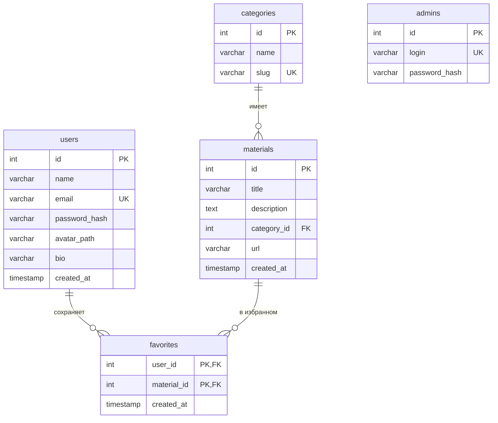

# Схема базы данных

## Диаграмма

## Таблицы

| Таблица | Назначение |
|----------|------------|
| `categories` | Справочник категорий (название только здесь) |
| `materials` | Учебные материалы, ссылка на категорию через `category_id` |
| `admins` | Учётные записи администраторов (пароль только как хеш) |
| `users` | Пользователи сайта: имя, email, аватар, «о себе» |
| `favorites` | Избранные материалы пользователя |

## Почему так меньше повторений

Название категории не копируется в каждую строку `materials`.  
В материале хранится только `category_id`. Чтобы показать название, делаем `JOIN`.  
Переименование категории в одном месте сразу видно у всех материалов.

`admins` и `users` разделены: админка и регистрация на сайте — разные роли.

## Файлы

- `sql/schema.sql` — создание БД и таблиц (включая `users`, avatar/bio, `favorites`)
- `sql/users.sql` — только таблица `users` (для уже существующей БД)
- `sql/profile.sql` — avatar/bio + favorites (если БД уже была)
- `sql/seed.sql` — 3 категории, 10 материалов, админ
- `sql/queries.sql` — примеры INSERT / SELECT / UPDATE / DELETE
